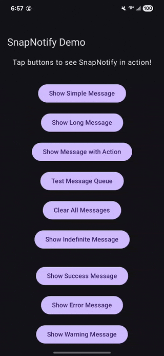

# SnapNotify

[](https://androidweekly.net/issues/issue-692)
[](https://central.sonatype.com/artifact/io.github.ivamsi/snapnotify/1.3.0)
[](https://opensource.org/licenses/Apache-2.0)

Show Jetpack Compose snackbars from Composables or ViewModels without passing SnackbarHostState through your application. SnapNotify provides a shared message queue, semantic styling, action callbacks, and optional top notifications.



## Scoped channels

Use a channel when a dialog, bottom sheet, or pane needs its own notification queue:

```kotlin
val cart = SnapNotify.channel("cart")
cart.showSuccess("Cart saved")
cart.showUndoable("Item removed", onAction = { restoreItem() })

SnapNotifyProvider { // Existing global queue
    MainContent()
    if (sheetOpen) {
        ModalBottomSheet(onDismissRequest = { sheetOpen = false }) {
            SnapNotifyProvider(channel = "cart") {
                CartContent()
            }
        }
    }
}
```

Use the same provider inside `Dialog { ... }`; no separate host adapter is needed. A channel provider
fills the available width and takes the height needed by its content or snackbar. A compact sheet
or dialog may grow while a message is visible so that the message and its controls fit. Pass
`Modifier.fillMaxSize()` for a full-screen host. It accepts the same placement, insets, styling, and
host slot as the global provider. `LocalSnapNotifyChannel.current` returns the nearest provider's channel.

Each channel has independent configuration, priority, deduplication, and overflow behavior. Configure
it with `cart.configure(SnapNotifyConfig(...))` and clear it with `cart.clear()`. Global `SnapNotify`
calls still target the global queue, including calls made inside a scoped provider.

Channel IDs are case-sensitive and must not be blank. The factory caches channels for the process
lifetime: use stable feature IDs, and clear queues when a feature closes to release pending callbacks.
Use one provider per channel across separate composition roots. Nested providers for an already
hosted channel reuse the ancestor host. Different channels may nest and display simultaneously.

## Installation

Ensure Maven Central is available in your project's dependency repositories:

```kotlin
// settings.gradle.kts
dependencyResolutionManagement {
    repositories {
        google()
        mavenCentral()
    }
}
```

Add the library to your application module:

```kotlin
// app/build.gradle.kts
dependencies {
    implementation("io.github.ivamsi:snapnotify:1.3.0")
}
```

## Quick start

Add a provider around your Compose content, then call `SnapNotify.show`. The provider is required; a show call alone does not install a host. The following example uses Material 3 components inside your existing application theme:

```kotlin
@Composable
fun NotificationExample() {
    SnapNotifyProvider {
        Button(onClick = { SnapNotify.show("Saved") }) {
            Text("Show snackbar")
        }
    }
}
```

For application-wide notifications, put the provider around your application content in `setContent` instead. Hilt is optional.

## Should I use SnapNotify?

| Your situation | Suggested approach |
| --- | --- |
| One screen with a simple snackbar | Compose's built-in SnackbarHostState may be enough; no additional dependency is necessary. |
| Notifications triggered from several Composables or ViewModels | SnapNotify offers a shared API and queue without passing host state to each caller. |
| Success, error, warning, or information messages | Use the semantic styling helpers. |
| Isolated notification queues per feature | Use a named channel and a provider for that channel. Provider placement alone does not create an independent queue. |

Keep notification calls in your presentation layer rather than adding a UI-library dependency to domain or data code.

## Common recipes

### Styled messages

```kotlin
SnapNotify.showSuccess("Profile saved")
SnapNotify.showError("Upload failed")
SnapNotify.showWarning("Unsaved changes")
SnapNotify.showInfo("Update available")
```

### Action callbacks

```kotlin
SnapNotify.show(
    message = "Message deleted",
    actionLabel = "Undo",
    onAction = { undoDelete() }
)
```

`undoDelete()` is application code that you provide.

### Custom durations

```kotlin
SnapNotify.show("Processing complete", durationMillis = 5000L)
```

### Undo with a timeout

```kotlin
SnapNotify.showUndoable(
    message = "Item moved to trash",
    onAction = { restoreItem() },
    durationMillis = 5000L,
    onTimeout = { permanentlyDelete() }
)
```

`restoreItem()` and `permanentlyDelete()` are application callbacks. Pressing the snackbar pauses the countdown. The action and close control do not run `onTimeout`. Do not use a UI timeout as your only mechanism for durable background work.

### Top notifications

```kotlin
SnapNotifyProvider(placement = NotificationPlacement.TopPill()) {
    AppContent()
}
```

`AppContent()` represents your application's Compose content. `TopBanner` and `BottomSnackbar` are also available.

### Queue configuration

```kotlin
SnapNotify.configure(
    SnapNotifyConfig(
        maxQueueSize = 50,
        onMessageDropped = { message ->
            // Handle a dropped message if your application needs to.
        }
    )
)

// Clear queued and current notification state when appropriate for your UX.
SnapNotify.clearAll()
```

The queue is bounded. When full, the lowest-priority oldest message is dropped; do not treat it as guaranteed delivery.

## Compatibility and integration notes

- Android minimum SDK: API 24.
- This is a Jetpack Compose library, not a replacement for Android system notifications.
- Keep a provider in the composition wherever notifications must be displayed.
- Global `SnapNotify` calls use the shared default queue. Named channels have independent queues; clear each channel when its feature's queued work is no longer relevant.
- Custom host rendering is available through `hostContent`; when supplied, the normal `placement` rendering is not applied.
- Validate the published artifact against your application's Kotlin and Compose versions before rollout. The repository build configuration does not establish compatibility with every consumer toolchain.

## Try the sample

Clone the repository and run the demo on an attached Android device or emulator:

```bash
./gradlew :SnapNotifyDemo:installDebug
```

The sample uses `project(":snapnotify")`. It exercises local source, not the Maven Central artifact.

## Releases and migration

See [CHANGELOG.md](CHANGELOG.md) for release history. Pin an explicit dependency version and review release notes before upgrading.

## Report an integration problem

[Open an issue](https://github.com/iVamsi/SnapNotify/issues) with your library, Kotlin, Compose, and Android versions, a minimal reproducer, and expected versus actual behavior. For provider or queue problems, include where the provider is installed and how messages are triggered. Do not include secrets or private application data.

## Development and testing

```bash
./gradlew :snapnotify:test
./gradlew :snapnotify:check
./gradlew check
```

Tests cover the queue, deduplication, countdown behavior, placement, and public show methods. Run the tasks to obtain current test results.

To validate a locally published artifact, run `./gradlew :snapnotify:publishToMavenLocal` and configure a separate consumer module with `mavenLocal()` and `io.github.ivamsi:snapnotify:1.3.0`. This does not verify the artifact hosted on Maven Central.

## Releasing (maintainers)

1. Update coordinates in `snapnotify/build.gradle.kts`, demo versionCode/versionName, CHANGELOG.md, and README dependency snippets.
2. Run `./gradlew check`.
3. Commit, create an annotated `vX.Y.Z` tag, and push the branch and tag.
4. Run `./gradlew :snapnotify:publishAndReleaseToMavenCentral` with the required Central Portal credentials and signing configuration. See [publishing setup](https://vanniktech.github.io/gradle-maven-publish-plugin/central/) and comments in gradle.properties.
5. Create a GitHub Release from the tag with the release notes.

## License

Copyright 2025 Vamsi Vaddavalli

Licensed under the [Apache License, Version 2.0](https://www.apache.org/licenses/LICENSE-2.0). The software is provided on an AS IS basis, without warranties or conditions of any kind. See the repository's license terms for details.
